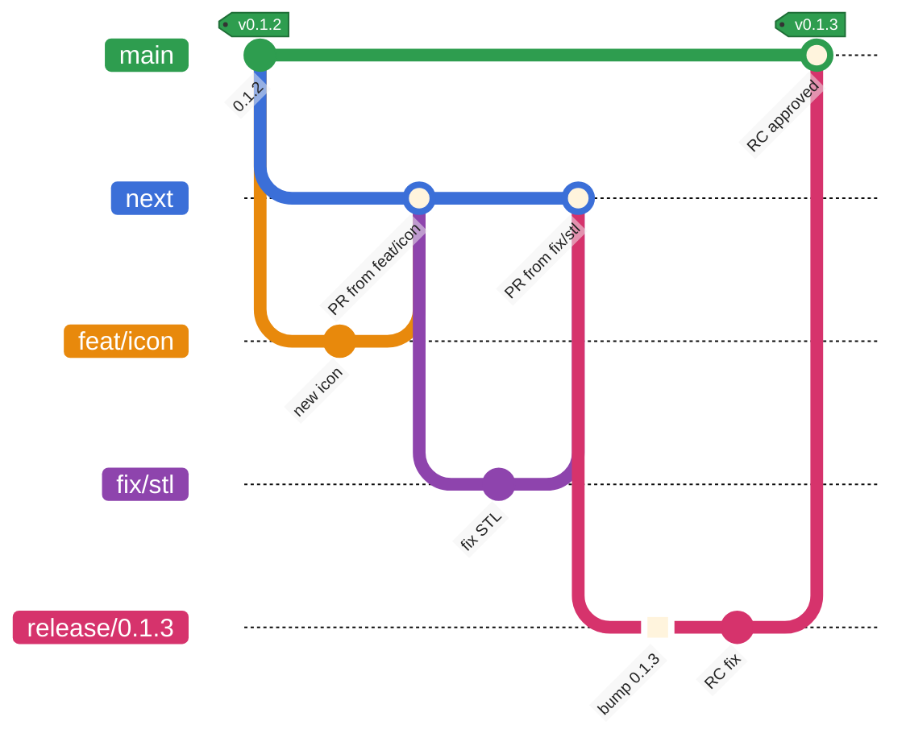

# Contributing

*[Español](CONTRIBUTING.md) · English · [Português](CONTRIBUTING.pt.md)*

This document explains how work on Trigonum is organized: the branch flow, what CI runs in
each case and how a version is released.

## Overview

A full cycle, from 0.1.2 to 0.1.3:



- `next` branches off `main` and receives features through pull requests.
- `release/0.1.3` is `next` **renamed**: that's why `next` ends exactly where
  `release/0.1.3` begins. The version is bumped there (the highlighted commit) and, if
  needed, whatever shows up while testing the RC is fixed there too.
- Merging `release/0.1.3` into `main` publishes the version: tag `v0.1.3`, OBS and AUR. The
  next cycle creates a new `next` from `main`.

| Branch | Lifetime | Purpose | What CI runs on its PRs |
|---|---|---|---|
| `main` | permanent | What has been released. Only accepts `release/X.Y.Z` branches. | Full CI (it's the RC) |
| `next` | one cycle | Collects what will go into the next version. | — (receives PRs, doesn't open them) |
| features (any name) | until merged | One specific change. They go to `next` through PRs. | Version rules and clippy |
| `release/X.Y.Z` | until released | `next` renamed. The only branch that bumps the version. | Rules and clippy for the fixes it receives; the full CI runs on its PR into `main` |

The idea is that only `main` is permanent: `next` branches off `main` every cycle and becomes
`release/X.Y.Z`, so no integration branch ever falls out of sync.

## Working on a feature

1. If it doesn't exist yet, create `next` from `main`:
   ```sh
   git fetch origin
   git switch -c next origin/main
   git push -u origin next
   ```
2. Create your branch from `next`, with any name you like:
   ```sh
   git switch -c feat/whatever origin/next
   ```
3. Note the change in the `[Unreleased]` section of `CHANGELOG.md`. Explanations go there, not
   as comments in the code.
4. Open the PR into `next`. CI checks the version rules and runs clippy; the jobs for the
   other distros finish green without building.
5. **Don't touch the version:** if the PR changes it, CI fails.

### Testing a branch's packages

In Forgejo: **Actions → CI → Run workflow**, then pick the branch. It runs the full CI on
Debian 13, Ubuntu 26.04, Arch, Fedora and openSUSE Tumbleweed, and keeps the packages (`.deb`,
`.rpm` and `.pkg.tar.zst`) as artifacts of the run for 30 days.

You can run the same on your machine with Docker:

```sh
build-aux/ci/run-local.sh all        # or: debian, ubuntu, arch, fedora, opensuse
```

The packages end up in `ci-out/`.

### If a feature doesn't work out

It simply isn't merged. If it already went into `next`, it's reverted there
(`git revert -m 1 <merge>`) before the version is released. Nothing reaches `main` without
going through an RC.

## Releasing a version

1. Review `[Unreleased]` in `CHANGELOG.md` on `next` and pick the version following
   [Semantic Versioning](https://semver.org/): `X.Y.Z+1` for fixes, `X.Y+1.0` for new
   features.
2. **Rename `next` to `release/X.Y.Z` in Forgejo:** **Branches tab → ✏️ on `next`**. Forgejo
   updates the open PRs that targeted `next` by itself. Do it from the web UI, not just with
   `git branch -m`: otherwise the old `next` stays on the server with the PRs pointing at it.
3. Bump the version on that branch:
   ```sh
   git fetch -p origin
   git switch release/X.Y.Z
   build-aux/bump-version.sh X.Y.Z
   ```
   The script changes the version in every file that repeats it (Cargo, meson, PKGBUILD,
   spec, `debian/changelog`, translations and metainfo) and turns `[Unreleased]` into
   `[X.Y.Z]`. It only works on `release/X.Y.Z`.
4. Commit, push and open the PR from `release/X.Y.Z` into `main`. **That PR is the RC**: it runs
   the full CI and leaves the packages for testing. If something needs fixing, it goes through
   a PR into `release/X.Y.Z`, and every push produces a new RC.
5. Merge the PR, with "delete branch after merge". The `release.yml` workflow:
   - creates the `vX.Y.Z` tag, which the mirror copies to GitHub;
   - uploads the source package to the Open Build Service, which builds for Debian 13,
     Ubuntu 26.04, Fedora and openSUSE;
   - updates the AUR;
   - warns if there's a leftover `next` that doesn't include the released version.
6. For the next cycle, go back to step 1 of "Working on a feature".

There are no hotfixes: any fix, however urgent, ships in a release, even if that release
carries a single change.

## Rules CI enforces

They're applied by `build-aux/ci/check-branch.sh` on every PR:

| PR | Rule |
|---|---|
| into `main` | Must come from `release/X.Y.Z`, with `X.Y.Z` equal to the version in `Cargo.toml`, and that version must not be released yet. |
| into `next` | Must not change the version. |
| into `release/X.Y.Z` | Must not change the version. |

If your branch's version doesn't match `next` because your branch fell behind (for example,
it was created before a release), bring in the changes with `git merge origin/next`.

## Forgejo settings

- **Branch protection:** only `main`, with the required checks pattern `CI / *` and no direct
  push. **Don't protect `next`**: if a wildcard rule covers it, Forgejo won't let you rename
  it, and if the rule is exact, it gets renamed along with the branch.
- **Repository settings:** enable "delete branch after merge" by default.
- **Actions secrets:** `OBS_PASSWORD` and `AUR_SSH_KEY`, plus the `OBS_USER` variable.

## CI images

CI uses its own images (`trigonum-ci/debian`, `ubuntu`, `arch`, `fedora` and `opensuse`) with
the tools, the dependencies and the crates from `Cargo.lock` already installed. The Arch one
also has clippy's dependencies already compiled. They're built on the runner host:

```sh
cd /opt/trigonum && git pull && build-aux/ci/build-images.sh
```

The timer in `build-aux/ci/host/` rebuilds them every Monday from `main`. You only need to do
it by hand to avoid waiting until Monday when dependencies change (`Cargo.lock`,
`debian/control`, the `.spec` or the PKGBUILD). Otherwise CI still works and downloads
whatever is missing.

## Code requirements

- **Rust 1.85 at minimum**, the one in Debian 13. Clippy warns if anything newer is used.
- **No explanatory comments about fixes in the code:** those go in `CHANGELOG.md`.
