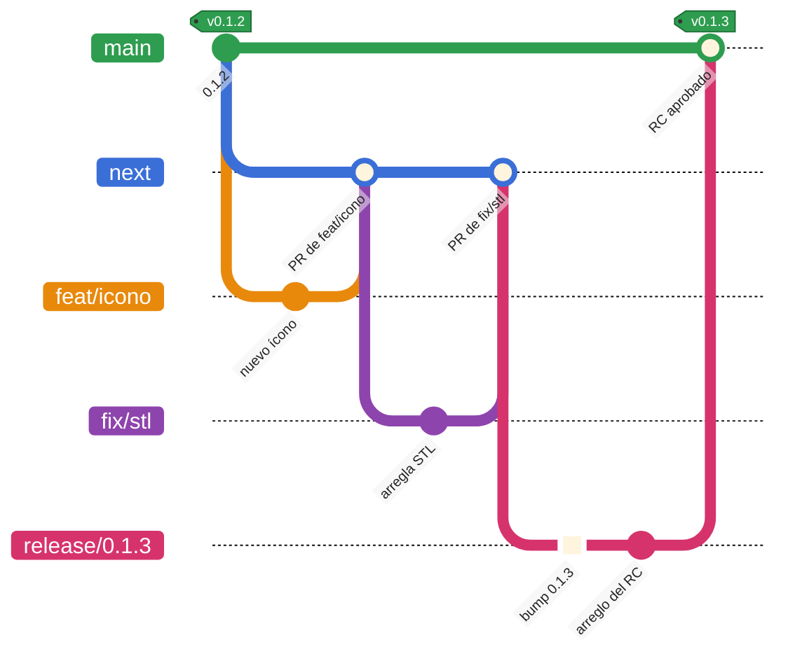

# Cómo contribuir

Este documento explica cómo se trabaja en Trigonum: el flujo de ramas, qué corre el CI en cada
caso y cómo se publica una versión.

## Resumen

Un ciclo completo, de la 0.1.2 a la 0.1.3:



- `next` sale de `main` y recibe las features por PR.
- `release/0.1.3` es `next` **renombrada**: por eso `next` termina justo donde empieza
  `release/0.1.3`. Ahí se sube la versión (el commit marcado) y, si hace falta, se arregla
  lo que aparezca al probar el RC.
- Mergear `release/0.1.3` a `main` publica la versión: tag `v0.1.3`, OBS y AUR. El próximo
  ciclo crea una `next` nueva desde `main`.

| Rama | Vida | Para qué | Qué corre el CI en sus PR |
|---|---|---|---|
| `main` | permanente | Lo publicado. Solo recibe ramas `release/X.Y.Z`. | CI completo (es el RC) |
| `next` | un ciclo | Junta lo que va a entrar en la próxima versión. | — (recibe PR, no los abre) |
| features (cualquier nombre) | hasta que se mergean | Un cambio concreto. Van por PR a `next`. | Reglas de versión y clippy |
| `release/X.Y.Z` | hasta publicar | `next` renombrada. La única rama que sube la versión. | Reglas y clippy para los arreglos que recibe; el CI completo corre en su PR a `main` |

La idea es que solo `main` sea permanente: `next` sale de `main` en cada ciclo y se convierte
en `release/X.Y.Z`, así ninguna rama de integración queda desincronizada.

## Trabajar en una feature

1. Si todavía no existe, crear `next` desde `main`:
   ```sh
   git fetch origin
   git switch -c next origin/main
   git push -u origin next
   ```
2. Crear tu rama desde `next`, con el nombre que quieras:
   ```sh
   git switch -c feat/lo-que-sea origin/next
   ```
3. Anotar el cambio en la sección `[Unreleased]` de `CHANGELOG.md`. Las explicaciones van ahí y
   no como comentarios en el código.
4. Abrir el PR hacia `next`. El CI verifica las reglas de versión y corre clippy; los jobs de
   las demás distros terminan en verde sin compilar.
5. **No toques la versión:** si el PR la cambia, el CI falla.

### Probar los paquetes de una rama

En Forgejo: **Actions → CI → Run workflow**, y elegís la rama. Corre el CI completo en Debian 13,
Ubuntu 26.04, Arch, Fedora y openSUSE Tumbleweed, y deja los paquetes (`.deb`, `.rpm` y
`.pkg.tar.zst`) como artefactos de la corrida durante 30 días.

Lo mismo se puede correr en tu máquina con Docker:

```sh
build-aux/ci/run-local.sh all        # o: debian, ubuntu, arch, fedora, opensuse
```

Los paquetes quedan en `ci-out/`.

### Si una feature no convence

Simplemente no se mergea. Si ya entró a `next`, se revierte ahí (`git revert -m 1 <merge>`)
antes de sacar la versión. Nunca llega a `main` sin pasar por un RC.

## Publicar una versión

1. Revisar `[Unreleased]` en `CHANGELOG.md` de `next` y elegir la versión siguiendo
   [Versionado Semántico](https://semver.org/lang/es/): `X.Y.Z+1` para arreglos, `X.Y+1.0` para
   funciones nuevas.
2. **Renombrar `next` a `release/X.Y.Z` en Forgejo:** pestaña **Ramas → ✏️ en `next`**. Forgejo
   actualiza solo los PR abiertos que apuntaban a `next`. Hacelo desde la web y no solo con
   `git branch -m`: si no, en el servidor queda la `next` vieja y los PR apuntando a ella.
3. Subir la versión en esa rama:
   ```sh
   git fetch -p origin
   git switch release/X.Y.Z
   build-aux/bump-version.sh X.Y.Z
   ```
   El script cambia la versión en todos los archivos que la repiten (Cargo, meson, PKGBUILD,
   spec, `debian/changelog`, traducciones y metainfo) y convierte `[Unreleased]` en `[X.Y.Z]`.
   Solo funciona en `release/X.Y.Z`.
4. Commitear, pushear y abrir el PR de `release/X.Y.Z` hacia `main`. **Ese PR es el RC**: corre el
   CI completo y deja los paquetes para probar. Si hay que arreglar algo, va por PR a
   `release/X.Y.Z`, y cada push genera un RC nuevo.
5. Mergear el PR, con "borrar la rama después del merge". El workflow `release.yml`:
   - crea el tag `vX.Y.Z`, que el espejo copia a GitHub;
   - sube el paquete fuente al Open Build Service, que compila para Debian 13, Ubuntu 26.04,
     Fedora y openSUSE;
   - actualiza el AUR;
   - avisa si quedó una `next` que no incluye la versión publicada.
6. Para el próximo ciclo, volver al paso 1 de "Trabajar en una feature".

No hay hotfixes: cualquier arreglo, por urgente que sea, sale en un release, aunque ese release
traiga un único cambio.

## Reglas que verifica el CI

Las aplica `build-aux/ci/check-branch.sh` en cada PR:

| PR | Regla |
|---|---|
| hacia `main` | Tiene que venir de `release/X.Y.Z`, con `X.Y.Z` igual a la versión del `Cargo.toml`, y esa versión no puede estar publicada. |
| hacia `next` | No puede cambiar la versión. |
| hacia `release/X.Y.Z` | No puede cambiar la versión. |

Si la versión de tu rama no coincide con la de `next` porque tu rama quedó atrasada (por
ejemplo, salió antes de un release), traele los cambios con `git merge origin/next`.

## Configuración en Forgejo

- **Protección de ramas:** solo `main`, con el patrón de checks obligatorios `CI / *` y sin push
  directo. **No protejas `next`**: si una regla con comodín la cubre, Forgejo no deja
  renombrarla, y si la regla es exacta, se renombra junto con la rama.
- **Ajustes del repo:** activar "borrar la rama después del merge" por defecto.
- **Secretos de Actions:** `OBS_PASSWORD` y `AUR_SSH_KEY`, y la variable `OBS_USER`.

## Imágenes de CI

El CI usa imágenes propias (`trigonum-ci/debian`, `ubuntu`, `arch`, `fedora` y `opensuse`) con
las herramientas, las dependencias y los crates del `Cargo.lock` ya instalados. La de Arch
trae además las dependencias de clippy ya compiladas. Se construyen en el servidor del runner:

```sh
cd /opt/trigonum && git pull && build-aux/ci/build-images.sh
```

El timer de `build-aux/ci/host/` las reconstruye cada lunes desde `main`. Solo hace falta
hacerlo a mano para no esperar al lunes cuando cambian las dependencias (`Cargo.lock`,
`debian/control`, el `.spec` o el PKGBUILD). Si no, el CI anda igual y baja lo que falta.

## Requisitos del código

- **Rust 1.85 como mínimo**, el que trae Debian 13. Clippy avisa si se usa algo más nuevo.
- **Sin comentarios explicativos sobre los arreglos en el código:** eso va en `CHANGELOG.md`.
