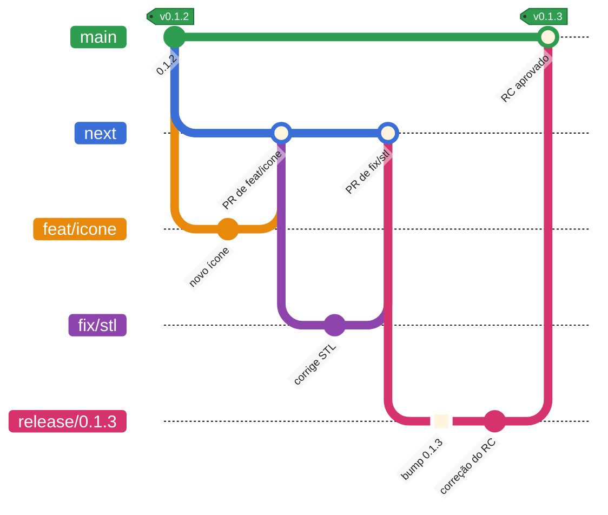

# Como contribuir

*[Español](CONTRIBUTING.md) · [English](CONTRIBUTING.en.md) · Português*

Este documento explica como se trabalha no Trigonum: o fluxo de branches, o que o CI roda em
cada caso e como uma versão é publicada.

## Resumo

Um ciclo completo, da 0.1.2 à 0.1.3:



- `next` sai de `main` e recebe as features por PR.
- `release/0.1.3` é a `next` **renomeada**: por isso `next` termina exatamente onde começa
  `release/0.1.3`. É ali que a versão é incrementada (o commit destacado) e, se for preciso,
  corrigido o que aparecer ao testar o RC.
- Mesclar `release/0.1.3` em `main` publica a versão: tag `v0.1.3`, OBS e AUR. O próximo
  ciclo cria uma `next` nova a partir de `main`.

| Branch | Vida | Para quê | O que o CI roda nos PRs dela |
|---|---|---|---|
| `main` | permanente | O que foi publicado. Só recebe branches `release/X.Y.Z`. | CI completo (é o RC) |
| `next` | um ciclo | Junta o que vai entrar na próxima versão. | — (recebe PRs, não abre) |
| features (qualquer nome) | até serem mescladas | Uma mudança concreta. Vão por PR para `next`. | Regras de versão e clippy |
| `release/X.Y.Z` | até a publicação | `next` renomeada. A única branch que incrementa a versão. | Regras e clippy para as correções que recebe; o CI completo roda no PR dela para `main` |

A ideia é que só `main` seja permanente: `next` sai de `main` a cada ciclo e vira
`release/X.Y.Z`, assim nenhuma branch de integração fica dessincronizada.

## Trabalhar em uma feature

1. Se ainda não existir, crie `next` a partir de `main`:
   ```sh
   git fetch origin
   git switch -c next origin/main
   git push -u origin next
   ```
2. Crie sua branch a partir de `next`, com o nome que quiser:
   ```sh
   git switch -c feat/o-que-for origin/next
   ```
3. Anote a mudança na seção `[Unreleased]` do `CHANGELOG.md`. As explicações vão ali, e não
   como comentários no código.
4. Abra o PR para `next`. O CI verifica as regras de versão e roda o clippy; os jobs das
   demais distros terminam em verde sem compilar.
5. **Não mexa na versão:** se o PR a alterar, o CI falha.

### Testar os pacotes de uma branch

No Forgejo: **Actions → CI → Run workflow**, e escolha a branch. Roda o CI completo no
Debian 13, Ubuntu 26.04, Arch, Fedora e openSUSE Tumbleweed, e deixa os pacotes (`.deb`,
`.rpm` e `.pkg.tar.zst`) como artefatos da execução por 30 dias.

Dá para rodar o mesmo na sua máquina com Docker:

```sh
build-aux/ci/run-local.sh all        # ou: debian, ubuntu, arch, fedora, opensuse
```

Os pacotes ficam em `ci-out/`.

### Se uma feature não convencer

Ela simplesmente não é mesclada. Se já entrou em `next`, é revertida ali
(`git revert -m 1 <merge>`) antes de sair a versão. Nada chega a `main` sem passar por um RC.

## Publicar uma versão

1. Revise `[Unreleased]` no `CHANGELOG.md` da `next` e escolha a versão seguindo o
   [Versionamento Semântico](https://semver.org/lang/pt-BR/): `X.Y.Z+1` para correções,
   `X.Y+1.0` para funcionalidades novas.
2. **Renomeie `next` para `release/X.Y.Z` no Forgejo:** aba **Branches → ✏️ em `next`**. O
   Forgejo atualiza sozinho os PRs abertos que apontavam para `next`. Faça isso pela web e não
   só com `git branch -m`: senão a `next` antiga fica no servidor com os PRs apontando para ela.
3. Incremente a versão nessa branch:
   ```sh
   git fetch -p origin
   git switch release/X.Y.Z
   build-aux/bump-version.sh X.Y.Z
   ```
   O script muda a versão em todos os arquivos que a repetem (Cargo, meson, PKGBUILD,
   spec, `debian/changelog`, traduções e metainfo) e transforma `[Unreleased]` em `[X.Y.Z]`.
   Só funciona em `release/X.Y.Z`.
4. Faça o commit, o push e abra o PR de `release/X.Y.Z` para `main`. **Esse PR é o RC**: roda o
   CI completo e deixa os pacotes para teste. Se for preciso corrigir algo, vai por PR para
   `release/X.Y.Z`, e cada push gera um RC novo.
5. Mescle o PR, com "apagar a branch depois do merge". O workflow `release.yml`:
   - cria a tag `vX.Y.Z`, que o espelho copia para o GitHub;
   - envia o pacote fonte ao Open Build Service, que compila para Debian 13, Ubuntu 26.04,
     Fedora e openSUSE;
   - atualiza o AUR;
   - avisa se sobrou uma `next` que não inclui a versão publicada.
6. Para o próximo ciclo, volte ao passo 1 de "Trabalhar em uma feature".

Não há hotfixes: qualquer correção, por mais urgente que seja, sai em um release, mesmo que esse
release traga uma única mudança.

## Regras que o CI verifica

São aplicadas por `build-aux/ci/check-branch.sh` em cada PR:

| PR | Regra |
|---|---|
| para `main` | Tem que vir de `release/X.Y.Z`, com `X.Y.Z` igual à versão do `Cargo.toml`, e essa versão não pode já estar publicada. |
| para `next` | Não pode mudar a versão. |
| para `release/X.Y.Z` | Não pode mudar a versão. |

Se a versão da sua branch não bate com a da `next` porque sua branch ficou para trás (por
exemplo, saiu antes de um release), traga as mudanças com `git merge origin/next`.

## Configuração no Forgejo

- **Proteção de branches:** só `main`, com o padrão de checks obrigatórios `CI / *` e sem push
  direto. **Não proteja `next`**: se uma regra com curinga a cobrir, o Forgejo não deixa
  renomeá-la, e se a regra for exata, ela é renomeada junto com a branch.
- **Configurações do repositório:** ative "apagar a branch depois do merge" por padrão.
- **Segredos do Actions:** `OBS_PASSWORD` e `AUR_SSH_KEY`, e a variável `OBS_USER`.

## Imagens de CI

O CI usa imagens próprias (`trigonum-ci/debian`, `ubuntu`, `arch`, `fedora` e `opensuse`) com
as ferramentas, as dependências e os crates do `Cargo.lock` já instalados. A do Arch traz
também as dependências do clippy já compiladas. Elas são construídas no servidor do runner:

```sh
cd /opt/trigonum && git pull && build-aux/ci/build-images.sh
```

O timer de `build-aux/ci/host/` as reconstrói toda segunda-feira a partir de `main`. Só é
preciso fazer à mão para não esperar até segunda quando as dependências mudam (`Cargo.lock`,
`debian/control`, o `.spec` ou o PKGBUILD). Caso contrário, o CI funciona igual e baixa o que
faltar.

## Requisitos do código

- **Rust 1.85 no mínimo**, o que vem no Debian 13. O clippy avisa se for usado algo mais novo.
- **Sem comentários explicativos sobre correções no código:** isso vai no `CHANGELOG.md`.
